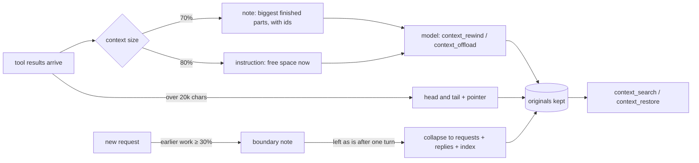
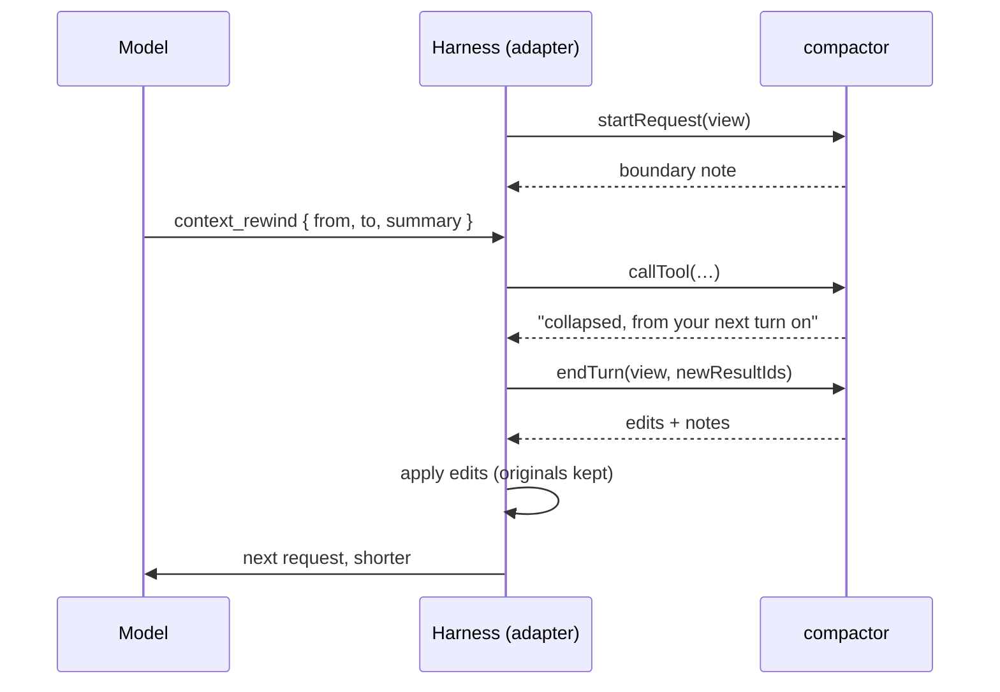

# compactor

[](https://www.npmjs.com/package/@nemanjan00/compactor)
[](LICENSE)

**Context management for coding agents that never throws anything away.**

A long agent session fills its context window with work that is already done: files read three tasks ago, a
log that was searched once, a whole earlier request. The usual fix is compaction: summarise everything at once
when the window is nearly full, and lose whatever the summary didn't copy.

compactor frees space in smaller steps, and the model takes part:

- **Collapse** a finished stretch of work into the model's own summary, with an index of every result it replaced.
- **Offload** a big tool result to a one-line pointer, and put it back when it's needed again.
- **Notes** tell the model how full its context is and name the biggest finished parts, with the ids to free them.
- **At a new request**, earlier finished requests are collapsed down to each request and its final reply.
- **Search and restore** reach every original: offloaded, collapsed, compacted, or on another branch of the session.

Nothing is deleted. Each change only alters what the model sees; the session keeps every original, so any
detail can be found and read back later.

The core doesn't depend on any agent harness. It ships with an adapter for the [pi coding agent](https://pi.dev),
and an adapter for another harness is a small module.

## Contents

- [Install for pi](#install-for-pi)
- [What the model sees](#what-the-model-sees)
- [Tools](#tools)
- [Configuration](#configuration)
- [How it fits a harness](#how-it-fits-a-harness)
- [Where the design comes from](#where-the-design-comes-from)
- [Development](#development)

## Install for pi

Requires pi 1.2 or later (it uses `context_edit` entries).

```sh
pi install npm:@nemanjan00/compactor
```

Add `-l` to install it for the current project only; pi loads project packages once you trust the project (or
with `--approve` for one run).

Or try it for one session without installing:

```sh
pi --extension ./node_modules/@nemanjan00/compactor/src/adapters/pi/index.js
```

Pi keeps its own automatic compaction; compactor works alongside it and frees space before it is needed. Its
search and restore also reach what pi compacted.

## What the model sees

Every tool result starts with its entry id, so the model can name it:

```
[entry 6533b688] row 0 of file 2: inventory count 2 units
…
```

When the context passes 70% of the window, a short note names what is finished and how to free it:

```
[context: about 142k of 200k tokens (71%)] The biggest finished parts:
- 047ddf3a … 2008f82e (read ×5) ≈ 34k tokens: once you've noted what you need from them, context_rewind { from: "047ddf3a", to: "2008f82e", summary }
- 9b1c22e0 (bash) ≈ 12k tokens: if you no longer need it verbatim, context_offload { entry: "9b1c22e0", text }
Collapse a part when it is done, keeping in the summary what the rest of the work needs verbatim (line numbers, quotes, ids).
```

At 80% the note becomes an instruction to free space before going on.

A collapsed stretch becomes the model's summary followed by an index of everything it replaced:

```
[collapsed with context_rewind: 7 entries, a4115dad … 2008f82e, about 34k tokens]
Five warehouse files: w0 apple SUP-100, w1 pear SUP-101, w2 kiwi SUP-102, w3 plum SUP-103, w4 fig SUP-104.
Keywords: warehouse, stock, fruit, supplier, vendor code

[index of what this replaced: find a detail in it with context_search { text }, or read one result back with context_restore { entry, offset: 0 }]
- read {"path":"w0.txt"} → entry 047ddf3a (≈3.4k tokens)
- read {"path":"w1.txt"} → entry 843b7ead (≈3.4k tokens)
…
```

A tool result over 20,000 characters is replaced at once by its head and tail, with how to read the rest.

When a new request starts and finished earlier requests take more than 30% of the window, a note suggests
collapsing them. If the model goes on without doing so, they are collapsed after its next turn: each request and
the final reply to it stay word for word, and the work in between becomes an index.



## Tools

| Tool | What it does |
|------|--------------|
| `context_rewind { from, to?, summary }` | Replaces a finished stretch, from the turn of `from` through the results of `to`, with the summary and an index. Later messages stay word for word. |
| `context_offload { entry, text }` | Replaces one tool result or message with a one-line pointer. |
| `context_restore { entry, offset?, length? }` | With `offset`/`length`: reads a piece of any original. Without them: puts an offloaded entry back. |
| `context_search { text, limit? }` | Full-text search over the whole session, including offloaded, collapsed and compacted entries and other branches. Each hit comes with a ready `context_restore` call. |

`from`, `to` and `entry` take entry ids (as in `[entry …]`) or tool call ids. A change made by a tool takes
effect from the model's next turn. Summaries are asked to end with a `Keywords:` line of the words a later question
might use, synonyms included, because search matches words, not meaning.

## Configuration

Every threshold has a default. For pi, override them with the `COMPACTOR_OPTIONS` environment variable:

```sh
COMPACTOR_OPTIONS='{"noteAt": 60, "boundaryAt": 25}' pi
```

| Option | Default | Meaning |
|--------|---------|---------|
| `noteAt` | `70` | Percent of the window at which the note about context size comes |
| `nearAt` | `80` | Percent at which the note becomes an instruction to free space |
| `contextWindow` | `null` | Manage against this window (tokens) when it is smaller than the model's |
| `compactAt` | `null` | Where the host compacts on its own, mentioned in the notes; thresholds at or above it are skipped |
| `boundaryAt` | `30` | Share of the window that finished earlier requests must take for a note at a new request (`0` = off) |
| `rearmMargin` | `15` | Points the context must fall below a noted threshold before it is noted again |
| `resultMaxChars` | `20000` | Tool results longer than this are offloaded as they arrive (`0` = off) |
| `pointerHead`, `pointerTail` | `2000`, `1000` | Characters of an oversized result kept from its start and end |
| `pieceMax` | `20000` | The most `context_restore` reads at once |
| `indexMax` | `40` | Lines an index lists at most |
| `searchLimit` | `10` | Hits `context_search` returns by default |
| `suggestionsMax`, `suggestionMinTokens` | `3`, `500` | How many parts a note names, and the smallest worth naming |
| `charsPerToken` | `3.5` | Used until the host reports a context size |
| `tools` | `context_*` | The tool names, e.g. `{"tools": {"search": "history_search"}}` |

## How it fits a harness

The core works on a plain list of history items and returns plain edits, so it knows nothing about any harness.
An adapter does three things: builds the items from its session, calls the compactor at four points, and applies
what comes back.

```js
const createCompactor = require("@nemanjan00/compactor").createCompactor;

const compactor = createCompactor({ noteAt: 70 });

// view = { items, all, usage: { tokens, window, baseChars } }
compactor.tools;                                   // tool specs: name, description, params, to register
compactor.callTool(name, args, view);              // → { text, isError }; changes wait for the end of the turn
compactor.endTurn(view, newResultIds);             // → { edits, notes } to apply before the next model call
compactor.startRequest(view);                      // → a note for a new request, or undefined
compactor.compact(job, complete);                  // → Promise<{ summary, usage }>, for hosts without their own compaction
```

**Items** are oldest first. `items` is what the model sees now; `all` holds every original, for search and restore.

```js
{ id: "e7", role: "user", text: "fix the date parser" }
{ id: "e8", role: "assistant", text: "", calls: [{ id: "call_1", name: "read", args: "{\"path\":\"a.js\"}" }] }
{ id: "e9", role: "toolResult", callId: "call_1", toolName: "read", isError: false, text: "…", images: 0 }
{ id: "n1", role: "note", text: "[context: …]", note: { kind: "note", level: 70 } }
{ id: "s1", role: "summary", text: "…" }                // the host's own compaction
{ id: "x1", role: "event", text: "…" }                  // anything else
```

**Edits** change only what the model sees. The last edit of a target wins.

```js
{ target: "e9", drop: true }              // leave it out
{ target: "e9", text: "…" }               // replace its text
{ target: "e8", calls: ["call_1"] }       // keep only these tool calls of an assistant turn
{ target: "e9", restore: true }           // put the original back
```

A collapse that starts at a tool-call turn keeps that turn's first call and puts the summary in its result, so the
history stays a valid sequence of calls and results for any provider.

**Notes** are `{ kind, level, tasks, text }`. Add each as a message the model sees, and give it back as a `note`
item, so a threshold isn't noted twice.

The pi adapter ([`src/adapters/pi`](src/adapters/pi)) is about 300 lines and a good template. In pi:

| Core | Pi |
|------|----|
| `items` | the session projection (`buildSessionProjection`), with `context_edit` entries applied |
| `all` | every entry of the session tree (`getEntries`) |
| `callTool` | `pi.registerTool`, with TypeBox schemas built from the specs |
| `endTurn` | `turn_end`, returning `context_edit` and hidden `custom_message` entries |
| `startRequest` | `before_agent_start`, returning a hidden message |
| entry labels | the `context` event prefixes each tool result with `[entry <id>]` |



## Where the design comes from

compactor is a port of the context management in
[meatless-proxy](https://github.com/nemanjan00/meatless-proxy), where it was measured against classic compaction
on long sessions ([CONTEXT.md](https://github.com/nemanjan00/meatless-proxy/blob/master/CONTEXT.md),
[every benchmark round](https://github.com/nemanjan00/meatless-proxy/blob/master/docs/benchmark.md)). Those
results are from that harness, not from pi. In short:

- A follow-up question about earlier work was answered from the collapse index for about 23k billed-equivalent tokens,
  against about 297k when compaction had dropped the detail and the model re-read the source.
- In a five-task chain, collapsing each finished task at the next request cost 24% less than classic compaction,
  with no compaction at all.
- Search matches words, not meaning; summaries carry a `Keywords:` line for that reason, and it helps but doesn't
  close the gap. Search by meaning is the open item.

## Development

```sh
yarn install
yarn test     # jest
yarn lint     # eslint
```

The core lives in `src/` (one folder per module, never importing a harness); adapters in `src/adapters/<harness>/`.
See [AGENTS.md](AGENTS.md) for the conventions.

## License

[MIT](LICENSE)
